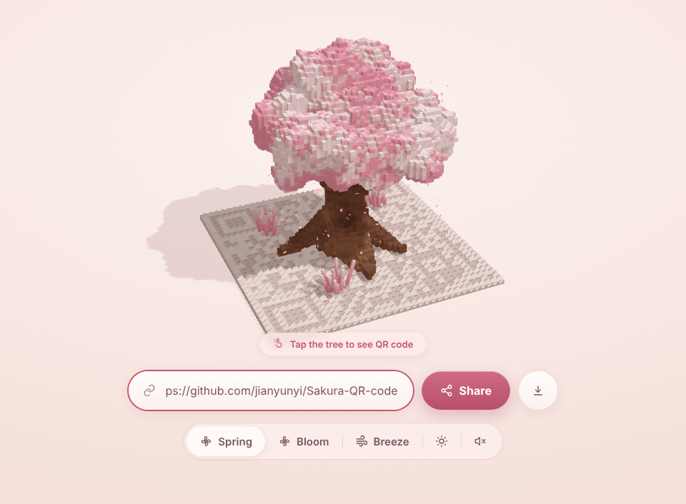
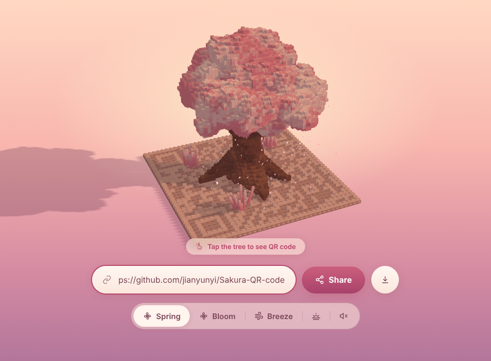
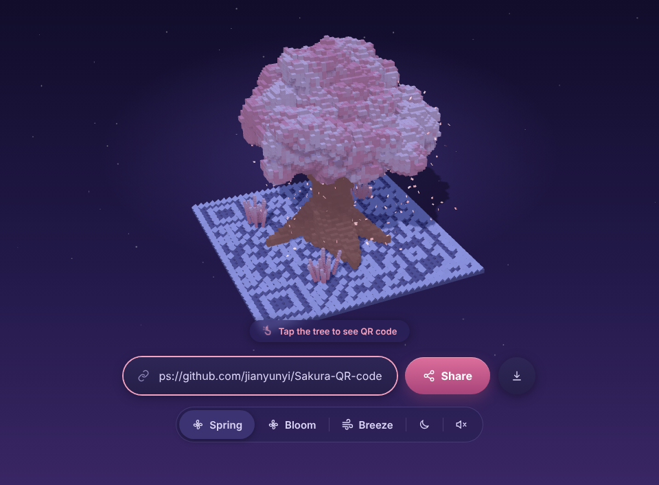
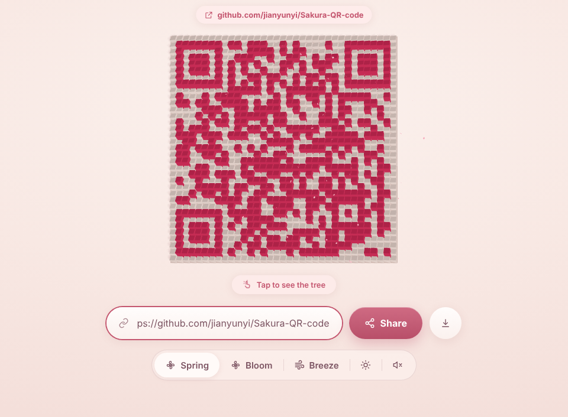
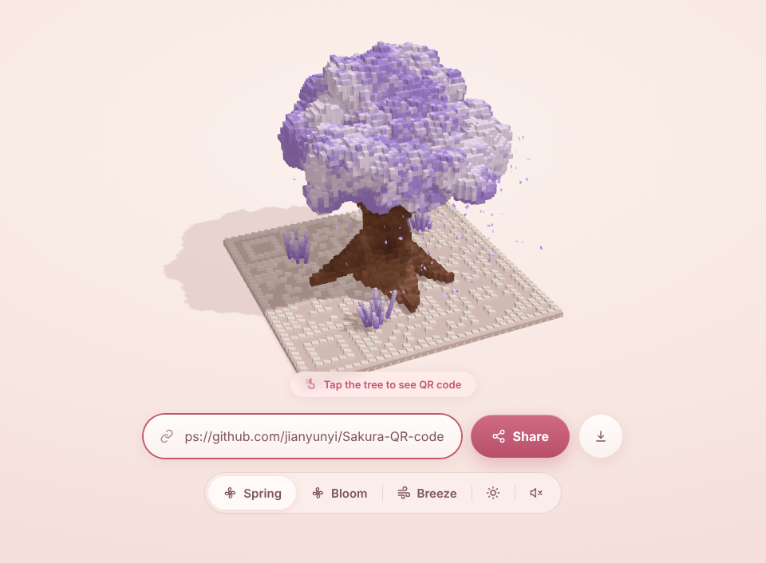
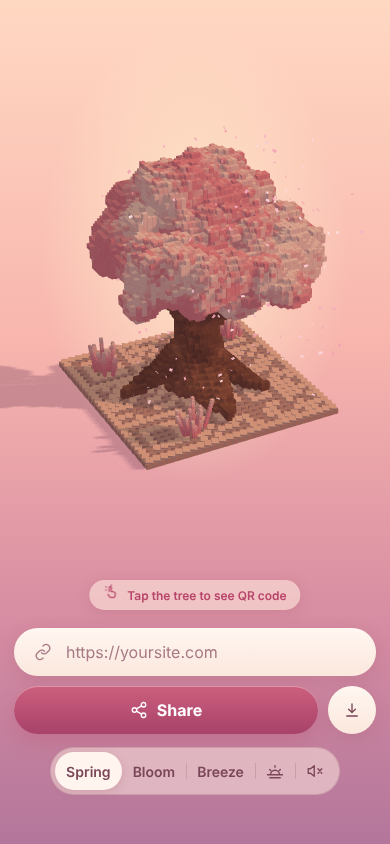

# 🌸 Sakura QR Code

3D 体素二维码：点击樱花树，树瓣纷飞、二维码从底板升起；再点一次，树重新长出来。
A voxel QR code that turns into a cherry-blossom tree (and back). Built with Three.js, ships as a vanilla module, a single-file bundle and a React / Next.js component.


<table>
  <tr>
    <td align="center"><br><sub>白天 · Day</sub></td>
    <td align="center"><br><sub>黄昏 · Dusk（长影子）</sub></td>
    <td align="center"><br><sub>夜晚 · Night（星空 + 花瓣微光）</sub></td>
  </tr>
  <tr>
    <td align="center"><br><sub>转场 · Transition</sub></td>
    <td align="center"><br><sub>二维码态 · QR（顶部"扫码直达"胶囊）</sub></td>
    <td align="center"><br><sub>主题色 · Purple</sub></td>
  </tr>
</table>

<p align="center"><br><sub>手机端布局 · Mobile</sub></p>

## 特性 Features
- **点击切换**：树体素按"冠 → 干"溶解成花瓣，深色模块从中心涟漪式升起并染成主题色，镜头从约 29° 斜视转为正俯视；反向动画自动对称。
- **三种光照主题**：`day` / `dusk` / `night`（或 `auto` 按本地时间）。黄昏有长影子，夜晚有星空和花瓣微光，切换时灯光、背景、UI 一起平滑过渡。
- **拖拽环绕**：在树态左右拖动旋转视角（带惯性），键盘 ←/→ 也能转；点击和拖拽不会互相误触。
- **扫码直达胶囊**：二维码态顶部显示链接域名，可直接点击打开（仅 http/https）。
- **导出 PNG**：一键保存可扫码的二维码图片（含 4 模块静区，已验证可解码）；`app.exportPNG()` 可用于自己的下载逻辑。
- **输入更聪明**：`github.com/xxx` 会自动补 `https://`；过长链接给出红框提示并保留上一个二维码；链接很长时提示"二维码会变密"。
- **程序生成体素樱花树**（扭曲树干、根系、枝干伸入树冠、白粉斑驳、板上小花丛），`seed` 可换树形。
- 6 种主题色、Spring / Bloom / Breeze 三种模式、可选音效、开场生长动画（`intro`）。
- **性能**：阴影静态缓存（场景静止时不再重绘阴影）、页面不可见/切后台自动暂停、低帧率自动降级（像素比 → 阴影分辨率 → 花瓣数）、尊重 `prefers-reduced-motion`。
- **无障碍与安全**：画布可聚焦（Enter/空格切换）、控件带 aria 标签、`aria-live` 提示；用户输入只通过 DOM 属性写入，不拼接 HTML；`destroy()` 会释放 GPU 资源与 WebGL 上下文（React StrictMode 下不泄漏）。

## 快速开始 Quick start

**单文件演示**：直接打开 [`examples/standalone.html`](examples/standalone.html)。

**原生 JS（bundle）**
```html
<div id="app" style="height:100vh"></div>
<script src="dist/sakura-qr-tree.bundle.js"></script>
<script>
  const app = SakuraQR.createSakuraQR(document.getElementById('app'), { url: 'https://yoursite.com' });
</script>
```

**React / Next.js**
```bash
npm i three qrcode-generator          # TS: npm i -D @types/three
cp -r react/ src/components/sakura/
```
```tsx
import { useState } from 'react';
import { SakuraQRTree, type SakuraState } from '@/components/sakura/SakuraQRTree';

export default function Hero() {
  const [state, setState] = useState<SakuraState>('tree');
  return (
    <div style={{ height: '100vh' }}>
      <SakuraQRTree url="https://yoursite.com" color="pink" state={state} onStateChange={setState} />
    </div>
  );
}
```
组件文件自带 `'use client'`，Three.js 在 `useEffect` 中懒加载，SSR 安全（Next App Router / Pages Router / Vite 均可）。父容器必须有高度。

## API

| 选项 / Prop | 默认 | 说明 |
|---|---|---|
| `url` | `https://yoursite.com` | 二维码内容 |
| `color` | `pink` | `pink purple red amber blue white` |
| `mode` | `spring` | `spring` 常态 · `bloom` 重播树冠生长 + 密集花瓣 · `breeze` 强风摇摆 |
| `state` | `tree` | `tree` / `qr` |
| `theme` | `day` | `day` `dusk` `night` `auto` |
| `intro` | `false` | 先显示二维码再长出树 |
| `adaptive` | `true` | 低帧率时自动降级画质 |
| `caption` | `true` | 二维码态顶部的链接胶囊 |
| `ui` | `true` | 输入框 / Share / 模式 / 色板 / 音效开关；`false` 仅画布 |
| `sound` `seed` `petals` `duration` | `false` `7` `460` `1.7` | 音效、树形种子、花瓣数、转场秒数 |
| 回调 | – | JS：`onToggle onShare onChange`；React：`onStateChange onUrlShare onChange` |

控制器 / ref：`toggle() setState() snap() seek(0..1) setUrl() setColor() setMode() setTheme() setSound() exportPNG() destroy()`；只读 `state theme quality progress matrix`。

`setUrl()` 返回 `boolean`（链接无法编码时返回 `false`）。`exportPNG({ size, ink })` 返回 `Promise<Blob>`。

## 工作原理 How it works
一个总进度 `m`（0 = 树，1 = 二维码）驱动全部动画：模块高度/颜色、树体素缩放、镜头俯仰、花瓣数量，因此反向播放天然对称。详见 [`skill/SKILL.md`](skill/SKILL.md)。

## 目录
```
src/        原生 ES 模块源码
tools/      bundle 入口与测试页（`npx esbuild tools/bundle-entry.js --bundle --minify --format=iife --outfile=dist/sakura-qr-tree.bundle.js`）
react/      React / Next.js 组件 + 类型声明
dist/       单文件 bundle（含 three + qrcode-generator）
examples/   standalone.html 单文件演示
skill/      可复用 skill 说明
docs/       README 样式图
```

> 说明：Bloom / Breeze 两种模式的具体表现为按风格推断实现；性能约 4–6 万体素实例，桌面 GPU 流畅，低端设备可调低 `petals`。

## License

[MIT](LICENSE) © 2026 jianyunyi
