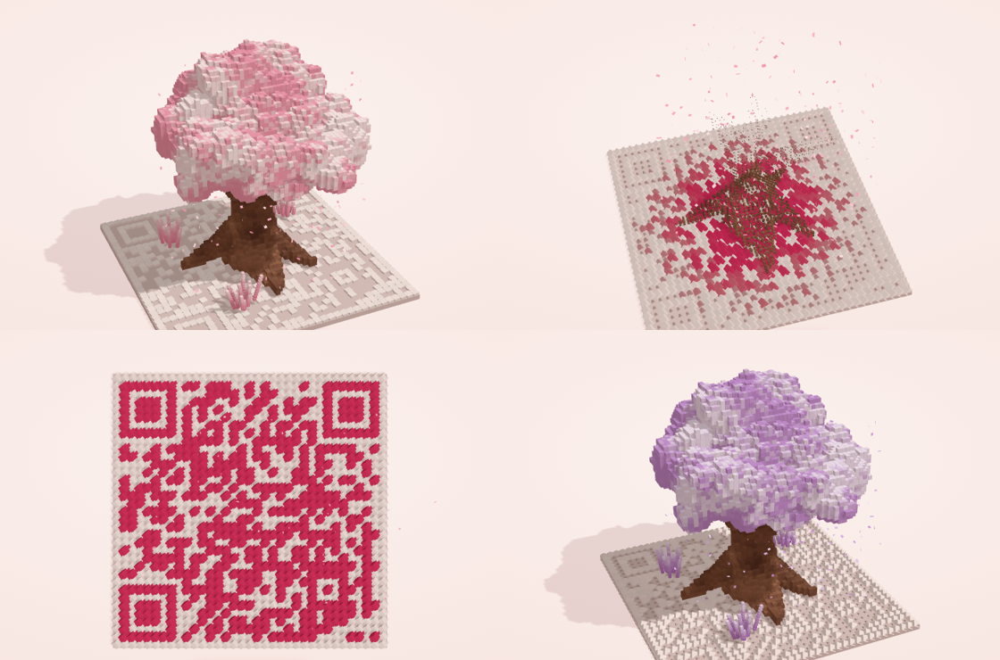
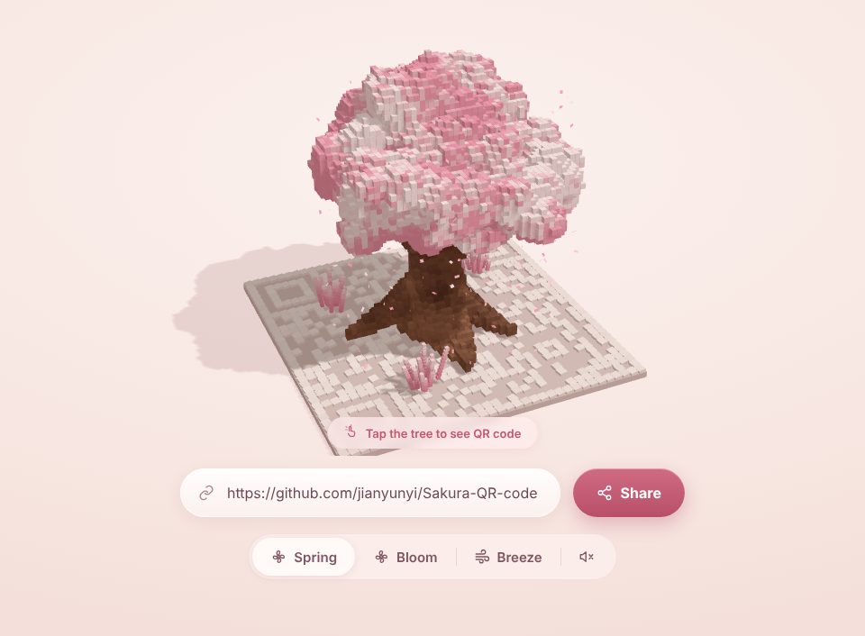
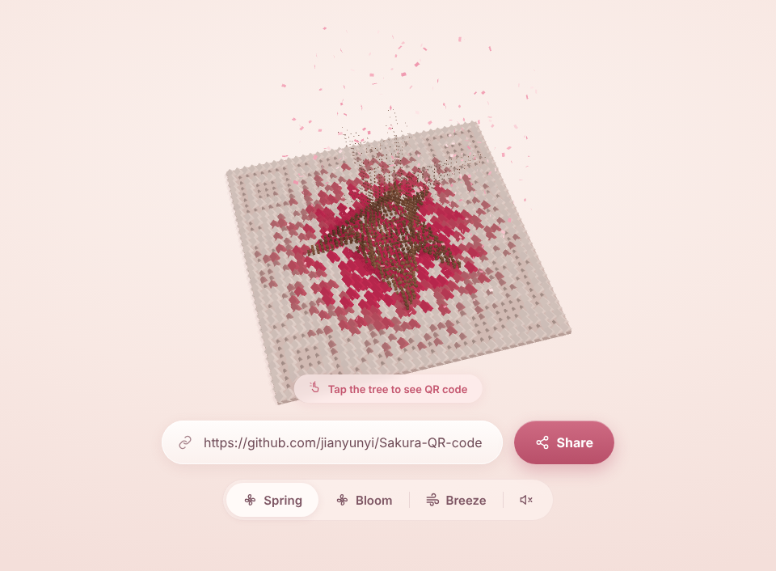
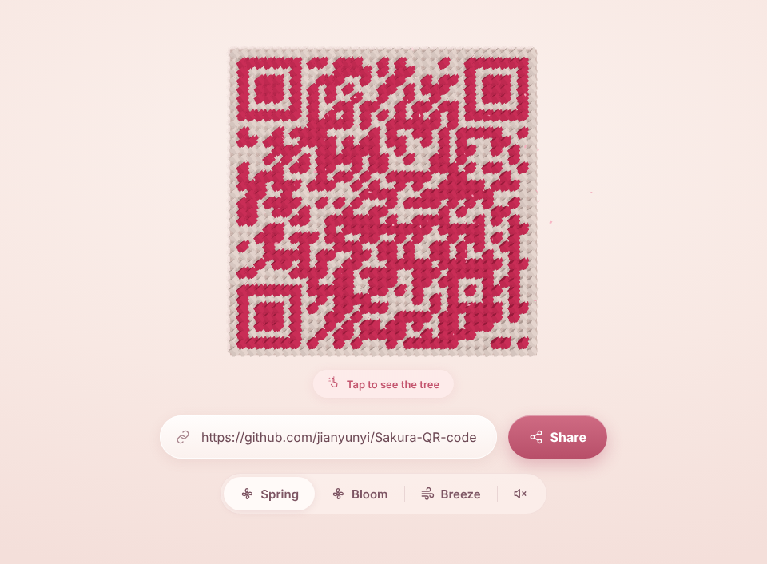
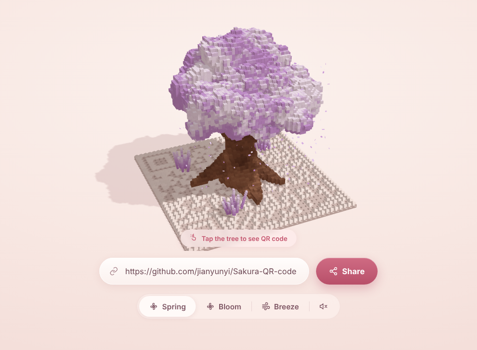

# 🌸 Sakura QR Code

3D 体素二维码：点击樱花树，树瓣纷飞、二维码从底板升起；再点一次，树重新长出来。
A voxel QR code that turns into a cherry-blossom tree (and back). Built with Three.js, ships as a vanilla module, a single-file bundle and a React / Next.js component.



<table>
  <tr>
    <td align="center"><br><sub>树态 · Tree</sub></td>
    <td align="center"><br><sub>转场 · Transition</sub></td>
  </tr>
  <tr>
    <td align="center"><br><sub>二维码态 · QR (top-down)</sub></td>
    <td align="center"><br><sub>主题色 · Purple theme</sub></td>
  </tr>
</table>

## 特性 Features
- 点击切换：树体素按"冠 → 干"溶解成花瓣，深色模块从中心涟漪式升起并染成主题色，镜头从约 29° 斜视转为正俯视；反向动画自动对称。
- 程序生成体素樱花树（扭曲树干、根系、枝干伸入树冠、白粉斑驳、板上小花丛），`seed` 可换树形。
- 输入 URL 实时重新生成二维码（可扫码），Share 按钮（系统分享 / 复制链接）。
- 6 种主题色：pink / purple / red / amber / blue / white。
- Spring / Bloom / Breeze 三种模式，可选音效（风声 + 提示音）。
- 花瓣粒子、体素阴影、风吹摇摆（顶点着色器）。

## 快速开始 Quick start

**单文件演示**：直接打开 [`examples/standalone.html`](examples/standalone.html)。

**原生 JS（bundle）**
```html
<div id="app" style="height:100vh"></div>
<script src="dist/sakura-qr-tree.bundle.js"></script>
<script>
  const app = SakuraQR.createSakuraQR(document.getElementById('app'), { url: 'https://yoursite.com' });
</script>
```

**React / Next.js**
```bash
npm i three qrcode-generator          # TS: npm i -D @types/three
cp -r react/ src/components/sakura/
```
```tsx
import { useState } from 'react';
import { SakuraQRTree, type SakuraState } from '@/components/sakura/SakuraQRTree';

export default function Hero() {
  const [state, setState] = useState<SakuraState>('tree');
  return (
    <div style={{ height: '100vh' }}>
      <SakuraQRTree url="https://yoursite.com" color="pink" state={state} onStateChange={setState} />
    </div>
  );
}
```
组件文件自带 `'use client'`，Three.js 在 `useEffect` 中懒加载，SSR 安全（Next App Router / Pages Router / Vite 均可）。父容器必须有高度。

## API

| 选项 / Prop | 默认 | 说明 |
|---|---|---|
| `url` | `https://yoursite.com` | 二维码内容 |
| `color` | `pink` | `pink purple red amber blue white` |
| `mode` | `spring` | `spring` 常态 · `bloom` 重播树冠生长 + 密集花瓣 · `breeze` 强风摇摆 |
| `state` | `tree` | `tree` / `qr` |
| `ui` | `true` | 输入框 / Share / 模式 / 色板 / 音效开关；`false` 仅画布 |
| `sound` `seed` `petals` `duration` | `false` `7` `460` `1.7` | 音效、树形种子、花瓣数、转场秒数 |
| 回调 | – | JS：`onToggle onShare onChange`；React：`onStateChange onUrlShare onChange` |

控制器 / ref：`toggle() setState() snap() seek(0..1) setUrl() setColor() setMode() setSound() destroy()`。

## 工作原理 How it works
一个总进度 `m`（0 = 树，1 = 二维码）驱动全部动画：模块高度/颜色、树体素缩放、镜头俯仰、花瓣数量，因此反向播放天然对称。详见 [`skill/SKILL.md`](skill/SKILL.md)。

## 目录
```
src/        原生 ES 模块源码
react/      React / Next.js 组件 + 类型声明
dist/       单文件 bundle（含 three + qrcode-generator）
examples/   standalone.html 单文件演示
skill/      可复用 skill 说明
docs/       README 样式图
```

> 说明：Bloom / Breeze 两种模式的具体表现为按风格推断实现；性能约 4–6 万体素实例，桌面 GPU 流畅，低端设备可调低 `petals`。
